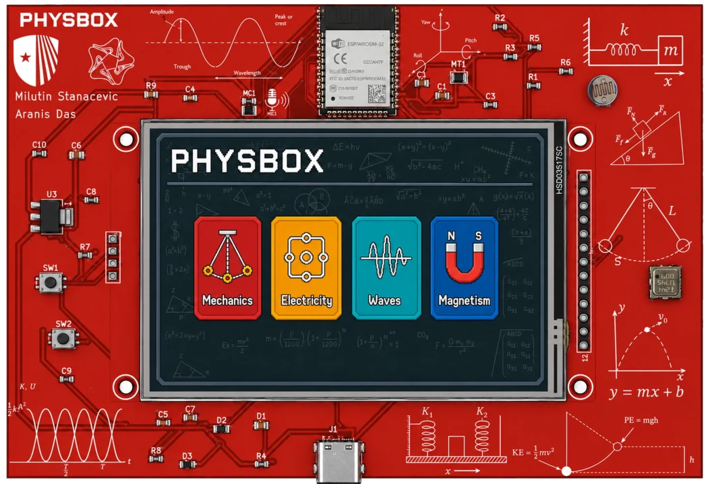
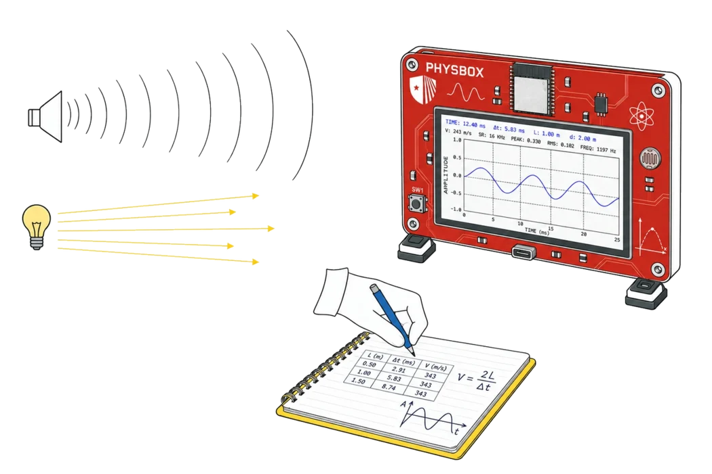
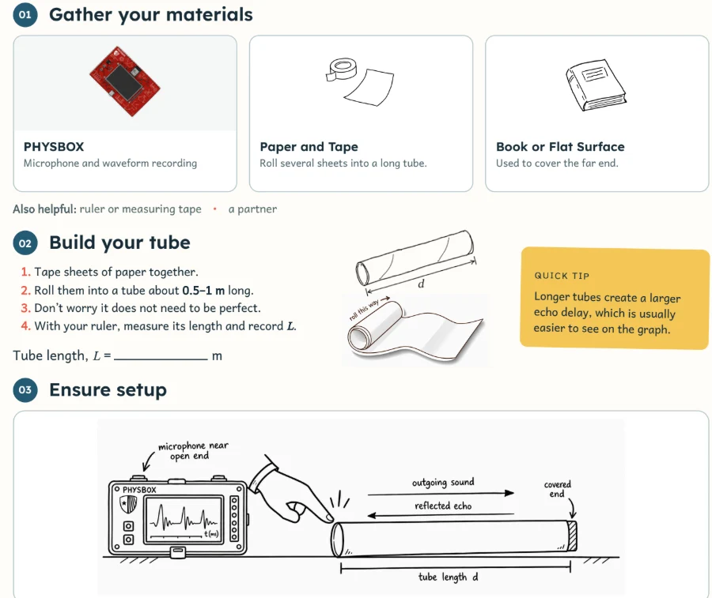
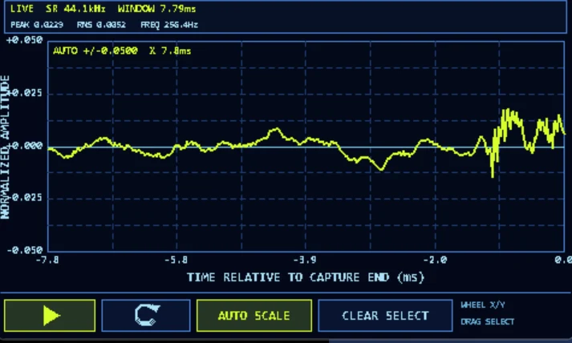
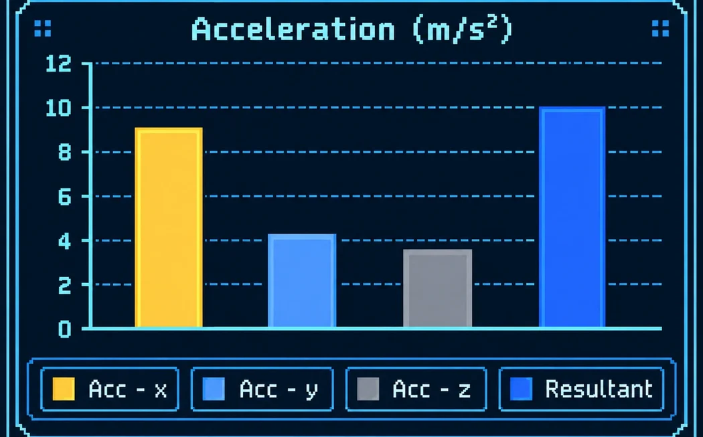
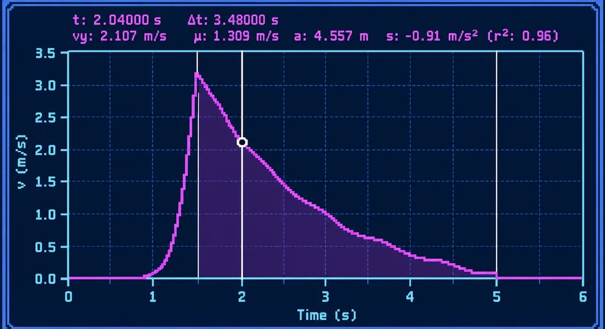
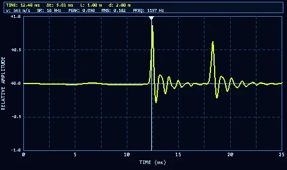
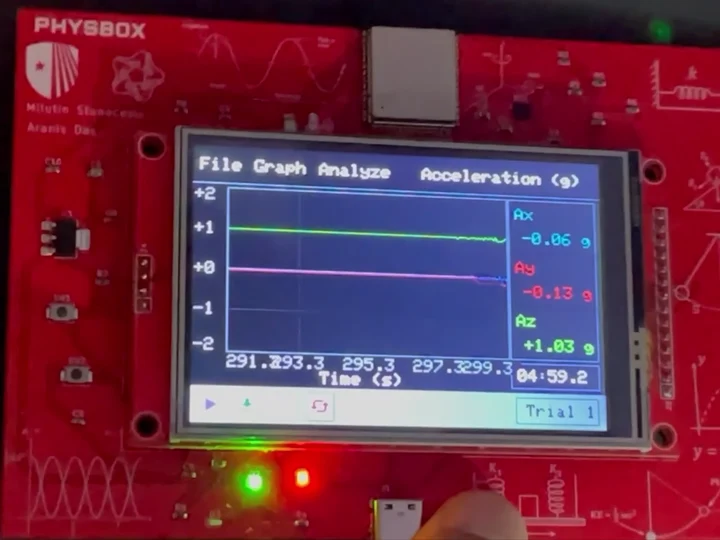

# PHYSBOX

**An offline physics lab for the classroom.** PHYSBOX combines sensors, a touchscreen, and on-device graphing in a handheld ESP32-S3 device. Students run an experiment, inspect the data with a stylus, and record what they find in a printed workbook. The lab runs without a laptop, phone, internet connection, or student account.

[Project page](https://aranis.me/physbox) · [Research paper (PDF)](https://aranis.me/pdfs/An%20Offline%2C%20Computer-Less%20Infrastructure%20for%20Scalable%20Physics.pdf) · [Speed of Sound workbook (PDF)](https://aranis.me/PHYSBOX/labs/lab01_speed_of_sound.pdf)

<p align="center">
  
</p>

## How a lab works

1. Follow the workbook to set up and run the experiment.
2. Collect sensor readings and inspect the graph directly on PHYSBOX.
3. Record measurements and compare trials in the workbook.
4. Connect the observed data to a physics concept or equation.

In the **Speed of Sound** lab, students use a paper tube to produce an echo, identify the two peaks in a microphone recording, and use the time between them and the tube length to calculate the speed of sound.

<p align="center">
  
  
</p>

## Graphing interface and hardware demos

These interface previews and recordings show the broader PHYSBOX project. The firmware on `main` starts in the IMU puck app described below.

| Live graph navigation | Multi-axis comparison |
| --- | --- |
|  |  |
| Pan, zoom, autoscale, and select a region of the waveform. | Compare acceleration along each axis with the resultant magnitude. |

| Interval analysis | Peak inspection |
| --- | --- |
|  |  |
| Inspect a time window and read measurements such as mean velocity, slope, and area. | Zoom in on peaks and measure the time between events. |

[](https://aranis.me/PHYSBOX/videos/web/full_imu.mp4)

[Live IMU tracking](https://aranis.me/PHYSBOX/videos/web/full_imu.mp4) · [Microphone and FFT](https://aranis.me/PHYSBOX/videos/web/fft.mp4) · [Pendulum lab concept](https://aranis.me/PHYSBOX/videos/web/pendulum_full.mp4)

## Run the firmware

Tilt the board to move a puck across a coordinate grid while watching live accelerometer and gyroscope readings. The repository also includes reusable display, IMU, microphone, and diagnostics modules.

Install [PlatformIO Core](https://docs.platformio.org/en/latest/core/installation/index.html) or the PlatformIO IDE extension. From the repository root, build and upload to the custom board with the `physbox` environment in [platformio.ini](platformio.ini).

```sh
pio run
pio device list
pio run -t upload --upload-port <port>
pio device monitor --port <port>
```

Replace `<port>` with the board's serial port, such as `COM3` or `/dev/ttyACM0`. The serial monitor runs at 115200 baud. On Windows, if `pio` is outside your PATH, invoke it with `& "$env:USERPROFILE\.platformio\penv\Scripts\pio.exe" run` in PowerShell.

### Try the desktop prototype

```sh
python -m pip install -r prototype/requirements.txt
python prototype/imu_ball.py
```

Use the arrow keys or WASD to move the puck. Press Space to reset and Esc to quit.

## Hardware reference

The firmware targets the **ESP32-S3-WROOM-1-N16R8** (16 MB flash, 8 MB PSRAM) on the custom PHYSBOX PCB.

| Interface | Component and settings | GPIO |
| --- | --- | --- |
| SPI display | ILI9488, 480 × 320 landscape, RGB666 at 10 MHz | CS 10, MOSI 11, SCK 12, MISO 13, DC 14, reset 15, backlight 16 |
| I²C IMU | ICM-42670-P, 100 Hz, ±16 g, ±2000 °/s | INT1 7, SDA 8, SCL 9 |
| I²S PDM microphone | SPH0641LU4H-1, 16 kHz mono, 16-bit via `ESP_I2S.h` | Clock 4, data 6 |
| Touch controller | Chip select defined in the pin map | CS 17 |

The [project page](https://aranis.me/physbox) also describes the PCB's light sensor and barometer, plus planned external probes.

## Source layout

| Path | Contents |
| --- | --- |
| [`src/main.cpp`](src/main.cpp) | Arduino entry point |
| [`src/apps/`](src/apps/) | IMU puck app and display rendering |
| [`src/display/`](src/display/) and [`src/sensors/`](src/sensors/) | Display, IMU, and microphone drivers |
| [`src/diagnostics/`](src/diagnostics/) | Reusable hardware diagnostic screen |
| [`include/`](include/) | Board pin map, firmware settings, and colors |
| [`prototype/`](prototype/) | Pygame desktop prototype |
| [`working_physbox/working_physbox.ino`](working_physbox/working_physbox.ino) | Standalone known-good Arduino hardware reference |

## Research

PHYSBOX was accepted as work in progress at [Learning at Scale 2026](https://learningatscale.hosting.acm.org/las2026/). The paper, [*An Offline, Computer-Less Infrastructure for Scalable Physics Laboratory Learning*](https://aranis.me/pdfs/An%20Offline%2C%20Computer-Less%20Infrastructure%20for%20Scalable%20Physics.pdf), explores how under-resourced classrooms can run hands-on labs with dedicated hardware and printed workbooks.
